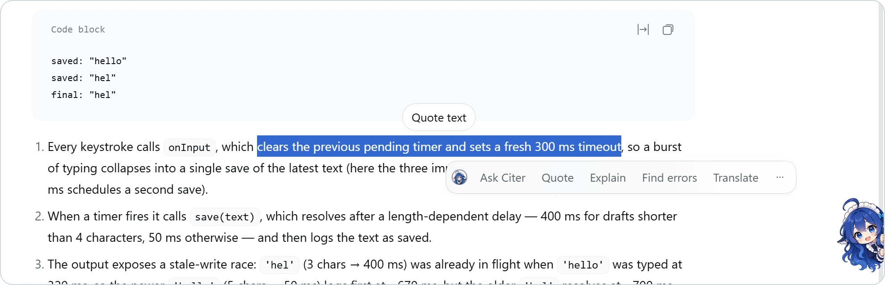
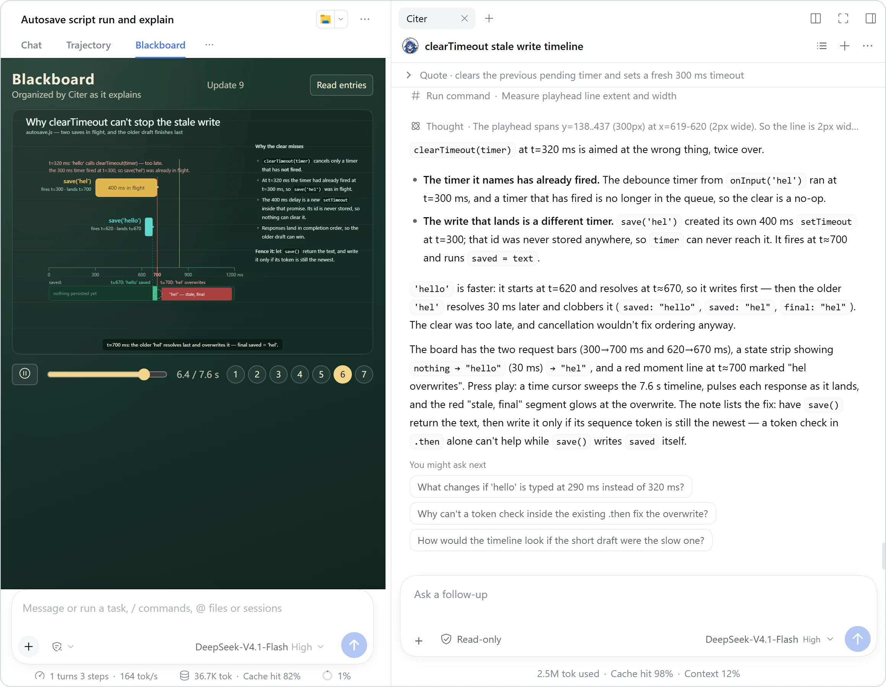
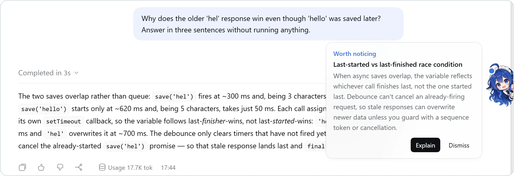

<div align="center">


# CiteCiter

**Your agent finished the job. Now understand how it did it.**

[](https://www.npmjs.com/package/@kirkchinese/dsh-citeciter) [](#install) [](https://github.com/kirkchinese/CiteCiter/blob/v0.9.0-beta.9/LICENSE)

[中文](README.zh.md) · **English** · [Changelog](https://github.com/kirkchinese/CiteCiter/blob/v0.9.0-beta.9/CHANGELOG.md) · [Issues](https://github.com/kirkchinese/CiteCiter/issues)

</div>

CiteCiter is a [DeepSeek Harness (DSH)](https://github.com/deepseek-ai/deepseek-harness) plugin for learning from your agent's real work. Select a passage in the conversation, a command or a document, ask about it in a separate Topic that keeps its source, see the key relations on a blackboard, then get back to work. The main conversation is never changed.

## Demo videos

<table>
<tr>
<td width="50%"><a href="https://www.bilibili.com/video/BV1Epno6jESr/"></a></td>
<td width="50%"><a href="https://www.bilibili.com/video/BV1H7no6SEjE/"></a></td>
</tr>
<tr>
<td align="center"><b>English</b> · 58 s · <a href="https://www.bilibili.com/video/BV1Epno6jESr/">Watch on Bilibili</a></td>
<td align="center"><b>中文</b> · 56 s · <a href="https://www.bilibili.com/video/BV1H7no6SEjE/">Watch on Bilibili</a></td>
</tr>
</table>

## How it works

### ① Select and ask

Select text in an answer, your own message, a tool result, a command card or a document and the Citer toolbar appears. Explain, Find errors and Translate send at once; Ask Citer lets you write your own question first; Quote drops the passage into the main composer as a quote chip, so you can discuss or dispute it with the main agent.



### ② Understand it in a Topic

Citer opens a Topic in the right sidebar. It knows which conversation the passage came from and reads it when needed, draws diagrams, derivations and animations on the blackboard, and takes as many follow-ups as you like. Topics are read-only by default and never write to the main conversation.



### ③ Teacher mode nudges you

When on, Citer has a cheap model of your choice look at each completed turn of the main conversation. If there is a point worth stopping for, a note appears beside the desktop pet: Explain opens a Topic that teaches it, Dismiss puts it away. Off by default.



> Explanations and boards can still be wrong. They help you understand and check; they do not replace evidence.

## Features

| You want to | What CiteCiter gives you |
| --- | --- |
| **Understand an answer, code, a command or a tool result** | A separate Topic that cites its source; follow-ups stay out of the main conversation |
| **See relations and processes** | A blackboard with Markdown, math, tables, SVG, images and sandboxed HTML; vision models check the rendered board and fix it; elements animate along keyframes, paths or formulas, with play, pause, scrub and steps |
| **Keep what you learned** | Learning cards you can export and revise, with prose and code examples shown apart |
| **Discuss real files** | File and image attachments; read documents and workspace files with Citer Reading in the right sidebar, select to ask, with line-numbered citations that lead back to the source |
| **Catch what is worth learning** | Teacher mode offers a point after each turn and teaches only when you ask |
| **Act on what you understood** | DSH's models, tools, approvals, permissions, queueing and steering; new Topics are read-only by default |
| **Pick up where you left off** | Drafts (text, references, attachments) and unsubmitted answers are saved and restored after a switch, refresh or restart, never sent on their own |

## Install

CiteCiter needs DSH and a working model. It declares only the oldest DSH it supports, so DSH updates never refuse to load it; if an update changes an API Citer uses, the affected feature may fail until a fix ships. Citer is checked against the newest DSH every day. Pick the release for your DSH:

| DSH version | CiteCiter version |
| --- | --- |
| `0.2.0-rc.2` and every later release (the official Desktop and every later alpha, release candidate and final release) | `0.9.0-beta.9` |
| `0.1.7-rc.2` | `0.9.0-alpha.3` |
| `0.1.5-rc.1` | `0.8.2` |
| `0.1.2-rc.1` | `0.6.0` |

**Desktop app.** Install the npm package `@kirkchinese/dsh-citeciter` from the Plugins page, or enter `https://github.com/kirkchinese/CiteCiter.git` in its Git field, then restart when prompted.

**CLI and Web.**

```sh
dsh plugin --profile web add @kirkchinese/dsh-citeciter@0.9.0-beta.9
```

You can also install a release tag straight from the repository, which ships the built plugin, so nothing is built at install time:

```sh
dsh plugin --profile web add "git+https://github.com/kirkchinese/CiteCiter.git#v0.9.0-beta.9"
```

Restart DSH and reload the page after installing or upgrading. Do not use `dsh plugin allow-version` to force a plugin that does not match your host version, and do not run two host processes on the same DSH home.

## Guide

<details>
<summary><b>Toolbar and actions</b></summary>

<br />

After you select text, the toolbar shows the first action (Ask Citer by default), then Quote, then the next three actions; the rest plus "Ask in a new Topic" are under "⋯". Actions go to the open Topic by default, or create one when there is none or it is archived.

- **Quote** puts the selected sentences into the main composer as a quote chip that looks like an `@file` chip, keeping the text and attachments already there. When you send, the main agent receives the exact passage and who said it (its reply, your message or a tool result), so it knows which sentence your next words are about. From DSH `0.2.1-rc.2`, sent messages show the quote as a chip too.
- **Ask Citer** opens the composer for your own question; preset actions such as Explain, Find errors and Translate send directly without touching an existing draft.
- **Command cards**: the command and arguments on a tool card can be selected too, and Citer knows they are the tool call's input.
- **Citer's own answers** show the toolbar as well; the action continues that Topic, and Quote adds the passage to that Topic's composer.
- **Customizing**: action names, prompts and order are configurable in Settings. If you prefer gestures, turn on the wheel: hold the right mouse button (or the chosen key) after selecting text, move to an action and release.

</details>

<details>
<summary><b>Right sidebar and desktop pet</b></summary>

<br />

Citer is a tab in DSH's right sidebar. Open it from the sidebar's guide page, the desktop pet or the toolbar; it sits beside files, terminals and other plugins' tabs, and can be split, floated or made fullscreen like them; closing the tab closes Citer. If you prefer a standalone panel, turn on "Don't use DSH's right sidebar" under Settings → Citer → Panel. The interface follows DSH's language (Chinese or English), and so do the names and prompts of the default actions; actions you changed stay as you wrote them. Each Topic shows its own usage under the composer: tokens, cache hit rate and context occupancy.

While Citer is closed, its mascot peeks over the window edge; she stands up when the pointer comes near, and a click opens Citer. Drag her to either side at any height and the place is remembered. A small dot appears next to her when an answer finishes, a question waits for you or teacher mode has a point for you.

</details>

<details>
<summary><b>Documents and files</b></summary>

<br />

Choose "Open document" in Citer's empty state, or import a `.md` / `.txt` file from the Documents page of the Topic list; the document opens as a tab in the right sidebar. Markdown is typeset (headings, lists, code blocks, math), text and code show line numbers, and long documents render as you scroll. Selecting text shows the same toolbar. A Topic asked from a document shows "document · line N" beside its quote; "Open source" returns to that passage and briefly highlights it.

Workspace files (including files opened by an absolute path, and common code, configuration, data and ROS files) open in DSH's own file preview; choose "Citer Reading" in its view menu to select and ask the same way, and asking saves a snapshot of the file to Citer's documents. Selecting a formula quotes its Markdown source. The Documents page searches and deletes documents; deleting removes only the document, and the Topics about it keep their conversations.

</details>

<details>
<summary><b>Teacher mode</b></summary>

<br />

Turn it on under Settings → Citer → Learning; it is off by default. When on, each time the main conversation you are looking at completes a turn, Citer has the teacher-mode check model (when unset, the Citer model, then the main conversation's) look at that turn for a point worth stopping to understand; routine file reads and commands do not count. When it finds one, a "Worth noticing" note appears beside the pet (at the top of Citer when it is open). Explain opens a Topic that reads that turn and teaches the point on the blackboard; Dismiss puts it away.

Each turn is checked once and costs one small extra model request, so a cheap, fast model can be chosen for it. It is the only Citer feature that calls a model without a click; once it is off, no checks are sent.

</details>

<details>
<summary><b>Composer and drafts</b></summary>

<br />

The composer offers attachments, permission mode, model and reasoning effort, and Send. Enter sends, Shift + Enter adds a line, and Enter never sends during IME composition. While a reply is generating, Enter follows DSH's queue/steer preference and Ctrl + Enter uses the other one. Add files from the attachment menu, paste images, or drop files onto the Citer panel.

Drafts save silently in the background. Edits to the same Topic from several windows merge automatically; where they overlap, the window you are typing in wins. After a successful send, only what was sent is cleared, and anything written meanwhile is kept.

</details>

<details>
<summary><b>Source, codebase and context</b></summary>

<br />

Every Topic knows which main conversation it belongs to, so Citer can read it at any time, even in a Topic that quotes nothing (and only that conversation). It reads a transcript of user and assistant messages, tool calls and results, each marked with its position; long tool output is shortened first and read in full only when needed. Turn on the automatic source excerpt in Settings to add the source's newest records at the start of each turn; it is off by default.

Codebase change awareness lists, at the start of each turn, the files that changed in the git working tree since Citer's previous turn, uncommitted changes included; Citer reads line-level diffs with a tool when they matter. Settings can attach the diffs directly or turn the notice off. Snapshots live in the Topic's own directory; your repository is never written.

A Topic lists all the context its model received (source excerpts, codebase changes, time and so on) by default, each row expanding to the exact text; the Topic menu can narrow the list to context notices. Of DSH's runtime facts a Topic keeps only the working directory, sent when it changes, and DSH's skill catalog is not sent to Topics. When a model request is retried, a Topic shows the retries and the failure reason as DSH's main conversation does. Tool calls use DSH's views too: file reads with line numbers, edits as diffs, commands with their output and exit code.

</details>

<details>
<summary><b>Learning route and cards</b></summary>

<br />

The learning route is off by default and can be turned on in the Topic menu (⋯); when on, the model plans its explanation with DSH todos. You can ask for learning cards at any time; the model checks conclusions, conditions and calculations first, but self-checking does not guarantee correctness. Active recall is off by default; when on, cards show their self-test question first.

</details>

<details>
<summary><b>Codex Connect</b></summary>

<br />

CiteCiter is adapted to the community plugin [Codex Connect](https://github.com/franksong2702/dsh-codex-connect) (`dsh-codex-connect`). With it installed and enabled in the same profile, Topics can use its ChatGPT / Codex models and GPT Image tools, and generated images appear under the tool card. Its image tools are enabled separately in Codex Connect's settings; see its documentation for installation, sign-in and supported DSH versions.

</details>

## Permissions and data

- **Read-only by default.** New Topics are read-only, even when the source session has more permissions. A Topic can change the workspace only after you choose another permission mode in the composer or change the default for new Topics; DSH approvals and sandboxing still apply.
- **Out of the session list.** Topics appear only in the Citer list. A new Topic starts with the excerpt or question as its title, and DSH's title service summarizes it on the first answer; once you rename it (double-click the title, press F2 or use the Topic menu) it no longer changes on its own; an archived Topic returns when you send to it again. Permanent deletion asks for the full Session ID and removes only that Topic's records, drafts, attachments and codebase snapshots.
- **Models.** New Topics use the model for new Topics set in Settings, or, when it is unset, the model selected in the source conversation. If that model does not exist in this DSH, the Topic is still created with its references and draft, and Citer asks you to pick an available model; it never switches models or sends on its own. A model that only cannot be reached for now, because of the network or a timeout, does not ask you to switch.

<details>
<summary>Where data lives</summary>

<br />

CiteCiter stores its data in each source session's directory:

```text
.dsh/sessions/<workspace>/<sourceSession>/
├── session.v4.jsonl[.zstd]   main session managed by DSH (never modified by Citer)
└── citeciter/
    ├── owner.json            directory ownership
    ├── <topicNumber>/
    │   ├── topic.json        Topic information
    │   ├── draft/            unsent text, references and attachments
    │   ├── question-drafts/  unsubmitted question answers
    │   ├── workspace/        codebase snapshots for change awareness (separate git objects)
    │   └── sessions/         the Topic's own session log
    └── deleted/              deletion records (identity only, no content)
```

Topics created before 0.8 are migrated into this layout at startup; their original logs are kept.

</details>

## Known issues

- On Windows, PowerShell in read-only mode may report a language-mode error or print garbled Chinese. This is a limitation of the DSH executor inside the read-only sandbox; CiteCiter does not loosen permissions to work around it.
- After the official Desktop restarts, other browser tabs still connected to the old backend may go blank; refreshing restores them. This also happens with CiteCiter disabled.
- Using different DSH versions one after another at the same browser address can leave the host's own draft data in an incompatible format so the main conversation does not render; use a different address or port per version.
- The plugin is mainly tested on Windows; Linux and macOS have not been systematically tested, and reports are welcome.

## Why CiteCiter

Practice usually produces two things: a result and a skill. We form judgment by trying, making mistakes, comparing approaches and verifying. AI can take over more and more of the execution, but it does not automatically hand the matching understanding to its user, so finishing a task and growing as a person can come apart.

CiteCiter turns real AI work into material you can cite, question and check. Start from the question in front of you, understand the principle, look at the evidence, and continue with a better understanding. Even when an agent does the work, people still need to set goals, understand the key conditions, judge whether a result applies, and take over when something goes wrong.

## Feedback

Bring a task where "the agent finished, but I still can't explain it" to the [issue tracker](https://github.com/kirkchinese/CiteCiter/issues), in English or Chinese. Include your DSH and plugin versions and whether you got stuck installing, citing and asking, or understanding the answer. Remove keys and private content before pasting material.

See [CONTRIBUTING.md](https://github.com/kirkchinese/CiteCiter/blob/v0.9.0-beta.9/CONTRIBUTING.md) for development and [docs/product.zh.md](https://github.com/kirkchinese/CiteCiter/blob/v0.9.0-beta.9/docs/product.zh.md) (Chinese) for the product rules. [Claude2DSH](https://github.com/kirkchinese/claude2dsh), by the same author, migrates sessions and assets between Claude Code and DSH.

MIT License.
