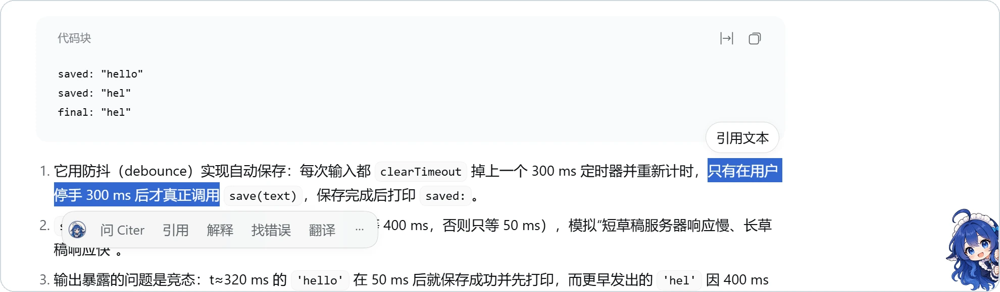
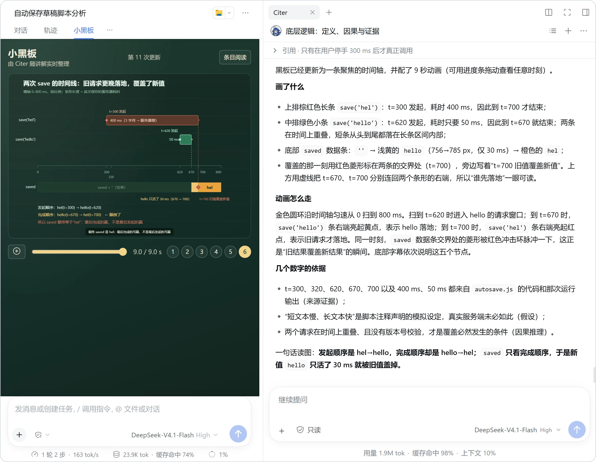
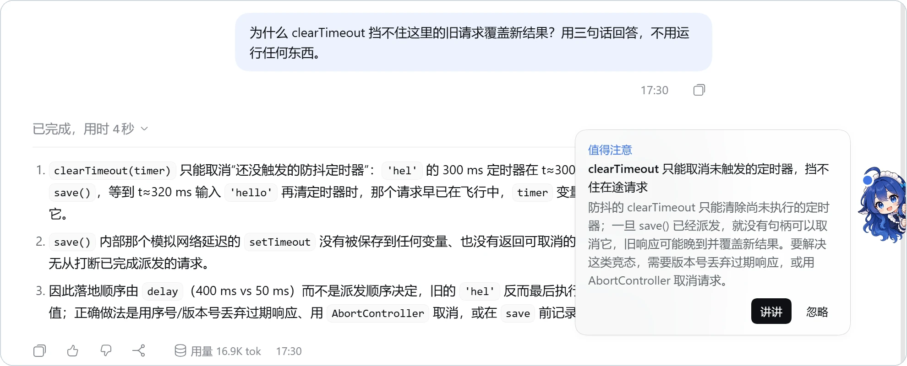

<div align="center">


# CiteCiter

**AI 已经完成了任务，我还想弄明白它是怎么做的。**<br /><sub><i>Your agent finished the job. Now understand how it did it.</i></sub>

[](https://www.npmjs.com/package/@kirkchinese/dsh-citeciter) [](#安装-install) [](https://github.com/kirkchinese/CiteCiter/blob/v0.9.0-beta.9/LICENSE)

**中文** · [English](README.md) · [更新记录 <sub>Changelog</sub>](https://github.com/kirkchinese/CiteCiter/blob/v0.9.0-beta.9/CHANGELOG.md) · [问题反馈 <sub>Issues</sub>](https://github.com/kirkchinese/CiteCiter/issues)

</div>

CiteCiter 是 [DeepSeek Harness（DSH）](https://github.com/deepseek-ai/deepseek-harness) 的插件，帮你从 Agent 的真实工作中学习：选中对话、命令或文档里的一段，在保留来源的独立 Topic 里追问，用小黑板看懂关键关系，再回到原来的工作。主对话不会被改动。

<sub>A DSH plugin for learning from your agent's real work: select a passage in the conversation, a command or a document, ask about it in a separate Topic that keeps its source, see the key relations on a blackboard, then get back to work. The main conversation is never changed.</sub>

## 演示视频 <sub>Demo videos</sub>

<table>
<tr>
<td width="50%"><a href="https://www.bilibili.com/video/BV1H7no6SEjE/"></a></td>
<td width="50%"><a href="https://www.bilibili.com/video/BV1Epno6jESr/"></a></td>
</tr>
<tr>
<td align="center"><b>中文版</b> · 56 秒 · <a href="https://www.bilibili.com/video/BV1H7no6SEjE/">在 B 站观看</a></td>
<td align="center"><b>English</b> · 58 s · <a href="https://www.bilibili.com/video/BV1Epno6jESr/">Watch on Bilibili</a></td>
</tr>
</table>

## 三步上手 <sub>How it works</sub>

### ① 选中，提问 <sub>Select and ask</sub>

在主对话的回答、你自己的消息、工具结果、命令卡片或文档里选中一段，旁边就会出现 Citer 工具条。“解释”“找错误”“翻译”直接发送；“问 Citer”让你先写下自己的问题；“引用”把这句话作为引用胶囊放进主对话的输入框，方便和主 Agent 讨论或反驳。

<sub>Select text in an answer, your own message, a tool result, a command card or a document and the Citer toolbar appears. Explain, Find errors and Translate send at once; Ask Citer lets you write your own question; Quote drops the passage into the main composer as a quote chip, so you can discuss or dispute it with the main agent.</sub>



### ② 在 Topic 里弄懂 <sub>Understand it in a Topic</sub>

Citer 在右侧栏打开一个 Topic。它知道这段话出自哪个主对话，需要时自己去读来源，在小黑板上画图、推导或做动画，你可以一直追问。Topic 默认只读，追问不会写进主对话。

<sub>Citer opens a Topic in the right sidebar. It knows which conversation the passage came from and reads it when needed, draws diagrams, derivations and animations on the blackboard, and takes as many follow-ups as you like. Topics are read-only by default and never write to the main conversation.</sub>



### ③ 教师模式提醒你 <sub>Teacher mode nudges you</sub>

开启后，主对话每完成一轮，Citer 会用你选的便宜模型看一眼这一轮；有值得停下来理解的知识点时，桌宠旁会出现提醒。点“讲讲”才会开 Topic 讲解，点“忽略”就收起。默认关闭。

<sub>When on, Citer has a cheap model of your choice look at each completed turn of the main conversation. If there is a point worth stopping for, a note appears beside the desktop pet: Explain opens a Topic that teaches it, Dismiss puts it away. Off by default.</sub>



> 解释和板书仍可能出错。它们帮助你理解和检查，不代替事实证据。<br /><sub>Explanations and boards can still be wrong; they help you understand and check, not replace evidence.</sub>

## 功能 <sub>Features</sub>

| 你想做什么 <sub>You want to</sub> | CiteCiter 提供什么 <sub>What CiteCiter gives you</sub> |
| --- | --- |
| **理解一段回答、代码、命令或工具结果**<br /><sub>Understand an answer, code, a command or a tool result</sub> | 带来源引用的独立 Topic，追问不会写入主对话<br /><sub>A separate Topic that cites its source; follow-ups stay out of the main conversation</sub> |
| **看懂关系与过程**<br /><sub>See relations and processes</sub> | 小黑板支持 Markdown、公式、表格、SVG、图片和隔离 HTML；支持视觉的模型会查看渲染结果并自行修正；元素可以按关键帧、路径或公式动起来，能播放、暂停、拖动和按步骤跳转<br /><sub>A blackboard with Markdown, math, tables, SVG, images and sandboxed HTML; vision models check the rendered board and fix it; elements animate along keyframes, paths or formulas, with play, pause, scrub and steps</sub> |
| **留下可回看的理解**<br /><sub>Keep what you learned</sub> | 可导出、可修订的学习卡，文字与代码示例分开展示<br /><sub>Learning cards you can export and revise, prose and code shown apart</sub> |
| **围绕真实文件讨论**<br /><sub>Discuss real files</sub> | 文件与图片附件；在右侧栏用“Citer 阅读”打开文档和工作区文件，选中即可提问，引用带行号并能回到原文<br /><sub>File and image attachments; read documents and workspace files with Citer Reading, select to ask, with line-numbered citations that lead back to the source</sub> |
| **及时发现值得学的点**<br /><sub>Catch what is worth learning</sub> | 教师模式在每轮结束后提醒，你点了才讲<br /><sub>Teacher mode offers a point after each turn and teaches only when you ask</sub> |
| **从理解继续动手**<br /><sub>Act on what you understood</sub> | 复用 DSH 的模型、工具、审批、权限、排队和插话；新 Topic 默认只读<br /><sub>DSH's models, tools, approvals, permissions, queueing and steering; new Topics are read-only</sub> |
| **暂停后继续**<br /><sub>Pick up where you left off</sub> | 草稿（文字、引用、附件）和未提交的问答自动保存，切换、刷新或重启后恢复，不会自动发送<br /><sub>Drafts and unsubmitted answers are saved and restored after a switch, refresh or restart, never sent on their own</sub> |

## 安装 <sub>Install</sub>

CiteCiter 需要 DSH 和一个可用的模型。插件只声明最低支持的 DSH 版本，DSH 以后的更新都不会再拒绝加载它；如果某次更新改了 Citer 用到的接口，受影响的功能可能出错，CiteCiter 每天都会对 DSH 的最新版本做兼容检查，并尽快发布修复。请按 DSH 版本选择：

<sub>CiteCiter needs DSH and a working model. It declares only the oldest DSH it supports, so DSH updates never refuse to load it; if an update changes an API Citer uses, the affected feature may fail until a fix ships. Citer is checked against the newest DSH every day. Pick the release for your DSH:</sub>

| DSH 版本 <sub>DSH version</sub> | 插件版本 <sub>Plugin</sub> |
| --- | --- |
| `0.2.0-rc.2` 及以上（含官方桌面版，以及之后的各个 alpha、rc 和正式版）<br /><sub>`0.2.0-rc.2` and every later release, including the official Desktop</sub> | `0.9.0-beta.9` |
| `0.1.7-rc.2` | `0.9.0-alpha.3` |
| `0.1.5-rc.1` | `0.8.2` |
| `0.1.2-rc.1` | `0.6.0` |

**官方桌面版** <sub>Desktop app</sub>　在插件页安装 npm 包 `@kirkchinese/dsh-citeciter`，或在 Git 地址一栏填写 `https://github.com/kirkchinese/CiteCiter.git`，然后按提示重启。<br /><sub>Install the npm package from the Plugins page, or enter the Git URL, then restart when prompted.</sub>

**命令行与 Web** <sub>CLI and Web</sub>

```sh
dsh plugin --profile web add @kirkchinese/dsh-citeciter@0.9.0-beta.9
```

也可以从仓库安装发布标签；仓库已包含构建好的插件，安装时无需构建。<br /><sub>Or install a release tag from the repository, which ships the built plugin:</sub>

```sh
dsh plugin --profile web add "git+https://github.com/kirkchinese/CiteCiter.git#v0.9.0-beta.9"
```

安装或升级后重启 DSH 并刷新页面。不要用 `dsh plugin allow-version` 强行加载与宿主版本不匹配的插件；同一个 DSH 主目录不要同时运行两个宿主进程。<br /><sub>Restart DSH and reload the page after installing or upgrading. Do not force a mismatched plugin with `allow-version`, and do not run two hosts on one DSH home.</sub>

## 使用说明 <sub>Guide</sub>

<sub>The full guide in English is in the [English README](README.md).</sub>

<details>
<summary><b>工具条与动作</b> <sub>Toolbar and actions</sub></summary>

<br />

选中文字后，工具条依次是第一个动作（默认“问 Citer”）、“引用”和其余前三个动作，剩下的动作和“在新 Topic 中提问”在“⋯”里。动作默认加入当前打开的 Topic，没有或已归档时新建。

- **引用**：把选中的句子作为引用胶囊放进主对话的输入框，和 `@文件` 的样子一样，已有的文字和附件都保留。发送时主 Agent 收到这段原文和它出自谁（它的回复、你的消息或工具结果），就知道你接下来的话针对哪一句。DSH `0.2.1-rc.2` 起，已发送的消息里也显示为引用胶囊。
- **问 Citer**：打开输入框让你写问题；“解释”“找错误”“翻译”等预设动作直接发送，不会改动输入框里已有的草稿。
- **命令卡片**：工具卡片里的命令和参数也能选中提问，Citer 会知道这是工具调用的输入。
- **Citer 自己的回答**：同样能选中，动作在这个 Topic 中继续，“引用”把选段加到这个 Topic 的输入框。
- **自定义**：动作的名称、提示词和顺序都可以在设置中修改。喜欢手势的话，可以开启轮盘：选中文字后按住右键（或设定的键）移向动作，松开即执行。

</details>

<details>
<summary><b>右侧栏与桌宠</b> <sub>Right sidebar and desktop pet</sub></summary>

<br />

Citer 是 DSH 右侧栏里的一个标签页，可以从侧栏的指引页、桌宠或工具条打开，和文件、终端、其他插件的标签并排、分屏、悬浮或全屏，关闭标签即收起。更喜欢独立面板的话，在设置 → Citer → 面板中打开“不使用 DSH 右侧栏”。界面语言跟随 DSH（中文或英文），默认动作的名称和提示词也随之切换，你改过的动作保持原样。Topic 在输入框下方显示自己的用量：token 数、缓存命中率和上下文占用。

Citer 收起时，桌宠会扒在窗口边缘探头；鼠标靠近时她会站起来，点一下就打开 Citer。可以把她拖到左边或右边的任意高度，位置会被记住。有回答完成、有问题在等你回答，或教师模式有提醒时，她旁边会出现一个小圆点。

</details>

<details>
<summary><b>文档与文件阅读</b> <sub>Documents and files</sub></summary>

<br />

在 Citer 的空状态点“打开文档”，或在 Topic 列表的“文档”页导入 `.md` / `.txt` 文件，文档会在右侧栏的标签页里打开：Markdown 正常排版（标题、列表、代码块、公式），文本和代码带行号，长文档边滚动边显示。选中文字就会出现同样的工具条。从文档提问的 Topic 在引用旁显示“文档名 · 第 N 行”，点“打开原文”回到那一段并短暂高亮。

工作区里的文件（包括按绝对路径打开的文件，以及常见的代码、配置、数据和 ROS 文件）用 DSH 自己的文件预览打开，在视图菜单中选“Citer 阅读”即可同样选文提问，提问时会把文件快照存入 Citer 的文档。选中公式时，引用的是它的 Markdown 原文。文档列表可以搜索和删除；删除只移除文档本身，相关 Topic 的对话保留。

</details>

<details>
<summary><b>教师模式</b> <sub>Teacher mode</sub></summary>

<br />

在设置 → Citer → 学习中开启，默认关闭。开启后，你正在看的主对话每完成一轮，Citer 会用“教师模式判断用的模型”（未设置时依次使用 Citer 的模型和主对话的模型）看一眼这一轮，判断有没有值得停下来理解的知识点；常规的读文件、跑命令不算。有的话，桌宠旁会出现“值得注意”的提醒（Citer 打开时显示在顶部）。点“讲讲”才会新建 Topic，读取主对话这一轮并用板书讲解；点“忽略”就收起。

每轮只判断一次，会多一次小的模型请求，可以为它单独选一个便宜快速的模型。这是 Citer 唯一会在你没有点击时调用模型的功能；关闭后不会再发任何判断请求。

</details>

<details>
<summary><b>输入与草稿</b> <sub>Composer and drafts</sub></summary>

<br />

输入框依次提供附件、权限模式、模型与思考强度、发送。Enter 发送，Shift + Enter 换行，输入法组词时 Enter 不会发送。生成过程中 Enter 跟随 DSH 的排队／插话设置，Ctrl + Enter 临时使用另一种方式。可以从附件菜单选择文件、粘贴图片，或把文件拖到 Citer 面板上。

草稿在后台静默保存。多个窗口编辑同一个 Topic 时，各自的修改会自动合并；同一处有冲突时，以正在输入的窗口为准。发送成功后只清除已发送的部分，发送期间新写的内容会保留。

</details>

<details>
<summary><b>来源、代码库与上下文</b> <sub>Source, codebase and context</sub></summary>

<br />

每个 Topic 都知道自己属于哪个主对话，即使没有引用任何内容，Citer 也能随时读取它（只能读这个主对话）。看到的是带位置标记的对话记录：用户与助手的消息、工具调用和结果；过长的工具输出先缩短，需要时再读全文。在设置中开启“自动附上来源摘录”后，每轮开头会附上来源最近的新内容，默认关闭。

“代码库变化感知”在每轮开头列出上一轮以来 git 工作区（含未提交的改动）改了哪些文件，Citer 需要时再用工具读取逐行改动；也可以在设置中改为直接附上 diff，或者关闭。快照存在 Topic 自己的目录里，不会写入你的仓库。

Topic 默认列出模型收到的全部上下文（来源摘录、代码库变化、时间等），展开即是原文，可以在 Topic 菜单中改为“只显示上下文通知”。DSH 的运行环境说明在 Topic 里只保留工作目录，且只在变化时发送；DSH 的技能目录不发给 Topic。模型请求失败重试时，Topic 和主对话一样显示重试进度和失败原因。工具调用也使用 DSH 的样式：读取文件带行号，编辑显示为 diff，命令显示输出和退出码。

</details>

<details>
<summary><b>学习路线与学习卡</b> <sub>Learning route and cards</sub></summary>

<br />

学习路线默认关闭，可以在 Topic 菜单（⋯）中开启；开启后，模型会根据问题用 DSH 待办安排讲解步骤。学习卡可以随时单独请求，生成前模型会核对结论、条件和计算，但自查不能保证正确。主动回忆默认关闭，开启后学习卡先显示自测问题。

</details>

<details>
<summary><b>Codex Connect</b> <sub>Image generation</sub></summary>

<br />

CiteCiter 适配了社区插件 [Codex Connect](https://github.com/franksong2702/dsh-codex-connect)（`dsh-codex-connect`）。在同一个 Profile 中安装并开启它之后，Topic 可以使用它接入的 ChatGPT / Codex 模型和 GPT Image 图片工具，生成的图片直接显示在工具卡下方。图片工具需要在 Codex Connect 的设置中单独开启；它的安装、登录和支持的 DSH 版本请见该插件的说明。

</details>

## 权限与数据 <sub>Permissions and data</sub>

- **默认只读** <sub>Read-only by default</sub>　新 Topic 默认只读，即使来源会话拥有更高权限。只有你在输入框中选择其他权限模式，或修改新 Topic 的默认权限后，Topic 才能修改工作区；DSH 的审批和沙箱规则照常生效。
- **不打扰会话列表** <sub>Out of the session list</sub>　Topic 只出现在 Citer 的列表里。新 Topic 先以摘录或问题为标题，第一次回答时由 DSH 的标题服务生成摘要标题；双击标题、按 F2 或在 Topic 菜单中重命名后不再自动修改；归档的 Topic 在你再次发送消息后自动恢复。永久删除需要输入完整的 Session ID，只删除这个 Topic 自己的记录、草稿、附件和代码库快照。
- **模型** <sub>Models</sub>　新 Topic 使用设置中“新 Topic 的模型”，未设置时沿用来源对话当前选择的模型。如果这个模型在当前 DSH 中确实不存在，Topic 照常创建，引用和草稿都保留，Citer 会提示你换一个可用的模型，不会自动换模型或发送；网络或超时导致暂时查不到模型时，不会要求换模型。

<details>
<summary>数据保存位置 <sub>Where data lives</sub></summary>

<br />

CiteCiter 的数据保存在每个来源会话的目录中：

```text
.dsh/sessions/<workspace>/<sourceSession>/
├── session.v4.jsonl[.zstd]   DSH 管理的主会话（Citer 不会改动）
└── citeciter/
    ├── owner.json            目录归属
    ├── <topicNumber>/
    │   ├── topic.json        Topic 信息
    │   ├── draft/            未发送的文字、引用和附件
    │   ├── question-drafts/  未提交的问答
    │   ├── workspace/        代码库变化感知的快照（独立的 git 对象）
    │   └── sessions/         Topic 自己的会话日志
    └── deleted/              删除记录（只含身份，不含内容）
```

0.8 之前版本创建的 Topic 会在启动时自动迁移到这个目录，原始日志保留不动。

</details>

## 已知问题 <sub>Known issues</sub>

- Windows 上，只读模式下的 PowerShell 可能报语言模式错误或输出中文乱码。这是 DSH 执行器在只读沙箱中的限制，CiteCiter 不会为此放宽权限。
- 官方桌面版重启后，仍连接着旧后台的其他浏览器标签页可能白屏，刷新即可恢复；停用 CiteCiter 时同样会出现。
- 在同一个浏览器地址上先后使用不同版本的 DSH，宿主自己保存的草稿格式可能不兼容，导致主对话无法显示；不同版本请使用不同的地址或端口。
- 插件主要在 Windows 上测试；Linux 与 macOS 未经系统测试，遇到问题欢迎反馈。

## 为什么做 CiteCiter <sub>Why CiteCiter</sub>

实践通常同时产生两样东西：成果和能力。我们通过尝试、犯错、比较方案和验证，逐渐形成判断。AI 可以接手越来越多的执行，却不会自动把相应的理解交给使用者，任务完成与人的成长可能因此分离。

CiteCiter 尝试把真实的 AI 工作过程变成可引用、可追问、可检验的学习材料。从眼前的一个疑问出发，理解原理、查看证据，再带着新的认识继续工作。即使把执行交给 Agent，人仍需要提出目标、理解关键条件、判断结果是否适用，并在出现异常时接管。

<sub>AI can take over more and more of the work, but it does not hand you the understanding that comes with doing it. CiteCiter turns real agent work into material you can cite, question and check, so finishing a task and growing your own judgment stay together.</sub>

## 反馈 <sub>Feedback</sub>

欢迎带着“Agent 已经完成了，但我还讲不清”的任务来[反馈](https://github.com/kirkchinese/CiteCiter/issues)。请写明 DSH 和插件版本，以及卡在安装、引用追问还是理解回答。贴材料前请移除密钥和私人内容。

开发说明见 [CONTRIBUTING.zh.md](https://github.com/kirkchinese/CiteCiter/blob/v0.9.0-beta.9/CONTRIBUTING.zh.md)，产品规则见 [docs/product.zh.md](https://github.com/kirkchinese/CiteCiter/blob/v0.9.0-beta.9/docs/product.zh.md)。同作者的 [Claude2DSH](https://github.com/kirkchinese/claude2dsh) 用于在 Claude Code 与 DSH 之间迁移会话和资产。

<sub>Issues and ideas are welcome in English or Chinese. Developer notes: [CONTRIBUTING.md](https://github.com/kirkchinese/CiteCiter/blob/v0.9.0-beta.9/CONTRIBUTING.md).</sub>

MIT License.
